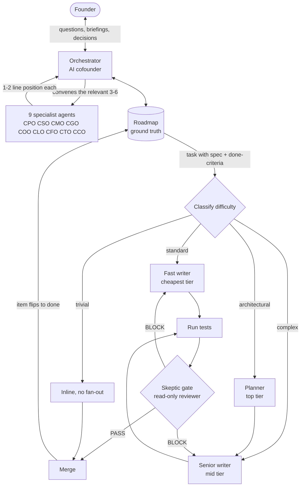

# 50fold (portfolio preview)

**An AI cofounder for a solo founder: one orchestrator agent that convenes nine specialist C-suite agents, routes coding work to the cheapest capable model, and keeps a 500+ task roadmap current on its own.**

This repo is a public preview of a private system. It shows what 50fold is and how it is designed. It does not contain the working implementation (see [What is in this preview](#what-is-in-this-preview-and-what-is-not)).

**Status:** used daily to run a live startup. Private beta / waitlist coming. **Contact:** [linkedin.com/in/nathajimetivier](https://linkedin.com/in/nathajimetivier/)

## What it is

- **An AI cofounder (the orchestrator)** that is the only agent the founder talks to. Frontier-model orchestrator, written as plain markdown.
- **Nine specialist agents**, one per executive seat: product, sales, marketing, growth/strategy, operations, legal, finance, technology, customer. Each has a written mandate, decision frameworks, hard nos, and a deliberate bias. They are built to disagree.
- **Model-tier routing ("Claudius")** for the coding work that falls out of decisions: classify each task, send it to the cheapest model that can do it well, and gate every non-trivial change behind an adversarial review.
- **A self-syncing roadmap** of every task between idea and launch (500+ tasks across 28 phases on the startup I used it for), with four statuses and a daily re-rank.
- **Daily and weekly briefings** that replace standups, a project tracker, and "what should I do today."

The name is the goal: give a team of one to three people the output of a fifty-person company.

## The problem

A solo founder has to make product, sales, finance, legal, and technical calls every day, with no one to argue with. Asking a single chatbot gets a single, agreeable voice. Coding agents add a second problem: they are fast and expensive, and the default is to run the strongest model on everything and to trust whatever it says about its own work.

50fold attacks both. Decisions get a roundtable of specialists with opposing incentives and one synthesizer who has to pick. Code gets cost-tiered routing and a reviewer whose only job is to find what is wrong.

## How it works

Two layers with one contract between them. The decision layer produces specs and priorities. The execution layer turns specs into merged, verified code. When the work merges, the roadmap item flips to done and the next morning's briefing re-ranks around it. That loop, run daily, is the whole system. Full write-up: [docs/architecture.md](docs/architecture.md).

## The operating loop

For any request, the orchestrator:

1. **Convenes** only the seats with a real stake. Three to six is typical; nine for a narrow question is a bug.
2. **Collects** a crisp 1-2 line position from each, read from that seat's own mandate file rather than guessed.
3. **Synthesizes and force-ranks.** "Both are important" is forbidden. Conflicts between seats are resolved by the orchestrator, not handed to the founder.
4. **Surfaces at most one founder-only decision**, plus one non-obvious insight it found by red-teaming its own ranking.
5. **Names who it left out**, so the founder can correct the roster.

A sample seat file is in [examples/cto.md](examples/cto.md).

## Model routing and cost discipline (Claudius)

Cheap model on the many, expensive model on the few. [claudius/design.md](claudius/design.md) has the condensed design.

1. **Classify** each coding task: Trivial, Standard, Complex, or Architectural. Anything touching security, auth, money, or migrations moves up a band automatically.
2. **Route** the writing to the cheapest capable model through subagents pinned to a model, so a cheap chat can still dispatch a strong writer.
3. **Verify.** A read-only skeptic reviews the diff against the spec's done-criteria and must return PASS before the work counts as done. It cannot edit; its instructions are to try to refute the change.

Two findings shaped the design:

- A one-day audit of the most expensive model found **54% of its spend came from ordinary chat**, not the coding pipeline. Routing only covers dispatched work, so a lightweight hook now flags when the chat itself is running on an oversized model.
- **A review's cost is rebuilding a cold context, not the text it writes.** So reviews run once per finished unit of work, scoped to the diff, and a re-review after a rejection checks only the changed lines.

## A short worked example

A roadmap item asked for an admin revenue view for an investor snapshot. Three seats convened (finance, technology, legal) and, because it touched money, the work escalated to the strongest reviewer. Tests passed. The reviewer still returned **BLOCK**: net revenue subtracted refunds twice, which would have understated revenue in a document sent to investors. One corrective migration, a re-check of the arithmetic, then PASS, merge, and the roadmap flipped itself. Full walk-through: [docs/worked-example.md](docs/worked-example.md).

## Design decisions and trade-offs

| Decision | Why | Cost |
| --- | --- | --- |
| Opinionated seats that conflict on purpose | Averaging specialists produces mush; a synthesizer forced to pick surfaces the real trade-off | The orchestrator has to be good at conflict resolution |
| One shared company profile file, not constraints repeated in nine personas | Repeated constraints drift; one edit updates the whole roster | Every seat depends on that file staying current |
| Markdown roadmap as the only tracker | Agents and the founder edit the same file; no second system to reconcile | Needs a truncation guard when a script mirrors it to HTML |
| Roadmap wins over a seat's wishlist unless the seat names a new concrete fact | Stops the orchestrator drifting toward whichever persona is loudest | A stale roadmap misleads, so the daily run must keep it fresh |
| Skeptic gate is read-only and escalates up on high-stakes work, never down | Separates the author from the judge; the standing setting is a floor, not a ceiling | Gate runs add cost, so they are batched |
| Trim review runs, not prompts | Cold-context rebuild dominates cost, so shorter prompts save almost nothing | Needs discipline about when a gate fires |
| Plain markdown personas, no runtime lock-in | Portable across agent runtimes, readable by non-engineers | Behavior depends on the runtime following the files |

## What is in this preview, and what is not

In this preview:

- [docs/architecture.md](docs/architecture.md) and [docs/worked-example.md](docs/worked-example.md)
- [examples/](examples/): one seat file (CTO), a trimmed roadmap sample, and the daily-briefing cadence
- [claudius/design.md](claudius/design.md): condensed routing-system design

In the private repo only: the orchestrator prompt and the other eight seat mandates, the install and uninstall tooling, hooks, agent and skill definitions, the roadmap-sync script and its tests, CI, and the Codex companion. Nothing here is sufficient to reproduce the working system.

## About

Built by Nathaji Metivier. [LinkedIn](https://linkedin.com/in/nathajimetivier/)

See [LICENSE](LICENSE): all rights reserved.
